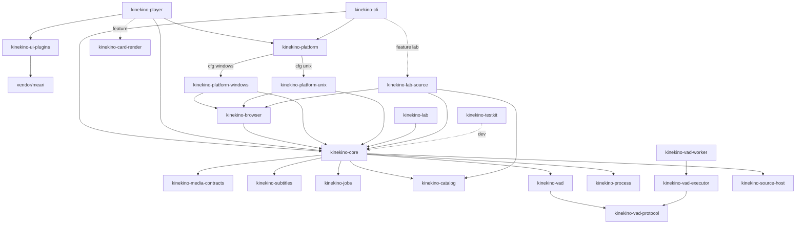

# kinekino 재설계안 — 작업 폴더·컨벤션 (초안 v1, 2026-10-29 KST)

대상: `/workspace/oink-player` (읽기 전용 분석. 파일 수정·이동·커밋·push 없음)
저장소: `modootoday/kinekino` (개발 단계 비공개) · 도메인 `kinekino.com` · 표시명 `키네키노`
전체 경로 매핑: `/workspace/kinekino-redesign-mapping.tsv`

표기: **[사실]** 이번 조사에서 직접 집계 · **[추정]** 판단·설계 · **[미확인]** 확인 못 함

---

## 0–3. 설계 계층·4원칙·네이밍

 정본은 [[sot:kinekino/conventions]]로 옮겼다(2026-10-29 specfold 정본화). 원문은 git 이력(커밋 b04d047)에 남아 있다.

## 4. 최상위 디렉토리 트리 (목표)

```
kinekino/
├── Cargo.toml                    워크스페이스 정의만
├── crates/
│   ├── kinekino-core/            공통 Rust SDK: 맥락별 domain+app (OS 중립, GUI/CLI 공용)
│   │   └── src/
│   │       ├── lib.rs
│   │       ├── product/          제품 식별(표시명·ID) 단일 출처
│   │       ├── sdk/              공개 typed API·요청/응답 스키마 (현 application/api)
│   │       ├── host_api/         로컬 호스트 API(CLI↔GUI 공용 엔드포인트)
│   │       ├── library/          미디어 소스·카탈로그 일반 계약(서비스 무관)
│   │       ├── playback/         재생 세션·제어·상태·옵션·경로
│   │       │   ├── domain/ app/ adapters/
│   │       ├── capture/          프레임 캡처·스냅샷 내보내기
│   │       ├── projects/         프로젝트 생성·저장·검증·import/export
│   │       ├── storage/          불변 저장·digest·원자적 게시
│   │       └── studio/           ★ 제품화 라인: 재생 후 AI 후속 작업
│   │           ├── subtitles/        자막·화자 주석·cue 편집
│   │           ├── cards/            카드 문서·번들
│   │           ├── shorts/           숏폼 클립 문서·렌더·프리셋
│   │           ├── subject_assets/   피사체 분할·레이어 에셋
│   │           ├── voice_activity/   VAD 작업 구성
│   │           ├── batches/          배치 작업·진행·취소
│   │           ├── models/           모델 카탈로그·provenance
│   │           └── review/           AI 결과 검토·제안·사용자 판정 이력
│   ├── kinekino-browser/         내장 브라우저: BrowserEngine 포트, 네트워크 원장, 콘텐츠 필터
│   │   └── src/{engine/{port, webview2, chromium}, network/, provider/, content_filter/}
│   ├── kinekino-platform/        OS 어댑터 선택 파사드 (cfg 게이트 유일 지점)
│   ├── kinekino-platform-windows/ win32 창·mpv parent_surface·WebView2 오디오·대화상자
│   ├── kinekino-platform-unix/   Linux/macOS 대응 구현 (신규)
│   ├── kinekino-cli/             바이너리 kinekino(kk): 명령 파싱·출력 포맷만
│   │   └── src/{main.rs, commands/<context>/, output/}
│   ├── kinekino-player/          바이너리 kinekino-player: GUI 조립·Meari UI
│   │   └── src/{main.rs, app/, ui/{shell, theme, components/<group>/, screens/<context>/, web_adapter/}}
│   ├── kinekino-ui-plugins/      Meari 플러그인 계약 구현
│   ├── kinekino-media-contracts/ 미디어 공용 값 계약
│   ├── kinekino-subtitles/ kinekino-jobs/ kinekino-catalog/ kinekino-card-render/
│   ├── kinekino-vad/ kinekino-vad-protocol/ kinekino-vad-executor/ kinekino-vad-worker/
│   ├── kinekino-process/         소유 프로세스 수명(src/platform/{windows,unix})
│   ├── kinekino-source-host/     외부 소스 SDK 호스트
│   ├── kinekino-testkit/         테스트 픽스처 (dev-dependency 전용)
│   ├── kinekino-lab/             개발 전용 라인: 검증·증거·custody (배포 제외, publish=false)
│   └── kinekino-lab-source/     source.example.test 전용: 카탈로그 파서·회차 해석·관측 스크립트·픽스처
├── xtask/                        cargo xtask: build-session, lint-structure, lint-deps, lint-names
├── vendor/meari/                 vendored UI 프레임워크 (exclude, 이름 유지)
├── assets/{fonts, design}        제품 공용 정적 자산 (크레이트 전용 자산은 각 crates/*/assets)
├── docs/{specs, adr, plans, design, history}
└── runtime/                      빌드 캐시·실행 산출물 (git 제외)
```
제품화 라인 판단 [추정]: AI 후속 작업은 처음엔 `kinekino-core::studio` 맥락으로 두고, 모델 추론 의존이 무거워지면 `kinekino-studio` 크레이트로 승격(모듈 경계를 그대로 크레이트 경계로).

---

## 5. 크레이트 의존 방향


규칙: core는 platform·browser·player·cli·lab을 모른다. 어떤 제품 크레이트도 lab에 일반 의존하지 않는다(CLI의 `lab` feature, 기본 off — Q4).
BrowserEngine 포트: `kinekino-browser/src/engine/port/` (trait `BrowserEngine`, `BrowserEvent`, `NetworkInterceptor`). 어댑터 `engine/webview2/`(`#[cfg(windows)]`, 현 infrastructure/browser 11파일+browser_provider 16파일 중 WebView2 종속분), `engine/chromium/`(cef-rs 또는 chromiumoxide 스파이크 — 바이너리 다운로드는 사용자 승인 필요, ADR 0001 대상).

---

## 6. 기존 → 신규 매핑 요약 (전체 69행 tsv)
| 기존 | 신규 |
|---|---|
| 루트 패키지 `kinekino-player` (`src/`) | 가상 매니페스트 + crates 분할 |
| `src/domain`+`application`+`infrastructure` 동일 맥락 | `kinekino-core/src/<context>/{domain,app,adapters}` |
| OS 종속 infrastructure (browser, mpv/parent_surface/win32, window_*, webview_audio, pickers) | `kinekino-platform-windows`, `kinekino-browser/engine/webview2` |
| `src/presentation`, `src/assembly`, `src/main.rs` | `kinekino-player` |
| `src/bin/player-cli*` | `kinekino-cli` (bin `kinekino`) |
| `src/test_support`, `tests/support` | `kinekino-testkit` |
| `tests/` (54 파일+19 디렉토리) | 소유 크레이트 `tests/<context>/` |
| `packages/media-*`, `owned-process`, `player-ui-plugins` | `crates/kinekino-*` (media- 접두 제거) |
| `packages/meari` | `vendor/meari` |
| `tools/validation`, `source375-custody` | `kinekino-lab` |
| `tools/resource-runner`, `tools/session-maintenance`(Python) | `xtask` |
| source.example.test 전용 코드·JS·픽스처 | `kinekino-lab-source` |
| `docs/spec/{sots,adrs,plans,artifacts}`, `docs/continuation` | `docs/{specs,adr,plans,design,history}` |

### 6.1 source 분리 범위 [사실 집계 + 분류 추정]
- 총 1,780회 / 463파일(코드·테스트·docs, meari·runtime 제외; 대소문자 무시). docs 188파일, src/tests/packages/tools 나머지.
- 코드 내 형태 상위: `kinekino_player` 543(크레이트 경로 → 크레이트 개명으로 소멸), `source.example.test` 120(39개 코드 파일), 환경변수 `SOURCE_*` 약 30, 바이너리/ID `source-validation.exe`, `source-dpi-lab`, `kinekino.player.*` ID.
- **순수 개발용 → lab-source**: `source.example.test` 카탈로그 파서(`packages/media-catalog/src/domain/location.rs`, parser 테스트), `src/infrastructure/browser/location.rs`의 호스트 판정, `assets/episode-observer.js`, `application/browser_network/test_fixture.rs`, `browser_provider/replay/fixture.rs`, 회차 해석 fixture, `tests/jobs/{resolve_cli,synthetic_browser,same_endpoint}`.
- **일반화 후 core로**: 회차 큐·인접 회차 전이(`episode_queue.rs`, `playback_session/transition/adjacency.rs`) → `library` 의 "Series/Item" 소스 포트; 네트워크 원장·문서 스코프(`browser_network/*`) → `kinekino-browser/network` (호스트 허용목록만 lab이 주입); 프로젝트 스키마의 소스 URL 검증(`domain/projects/validation.rs`) → 허용 소스 정책 주입.
- **개명만**: `kinekino_player` 경로, `SOURCE_*` env → `KINEKINO_*`, `kinekino.player.*` ID → `com.kinekino.*`(데이터 마이그레이션 필요).
- `oink`: 1건 (`README.md:1` 제목) [사실]. `오잉크`: 0건 [사실].

---

## 7. 단계별 이전 계획
각 단계 공통 검증: `cargo fmt --all --check` → `cargo check --workspace --all-targets --locked` → `cargo clippy --workspace --all-targets -- -D warnings` → `cargo test --workspace` (Linux 개발 장비; Windows 결과는 [미확인]로 별도 표기). 단계마다 별도 커밋, 이동은 `git mv`로 이력 보존.

| # | 단계 | 내용 | 검증 추가 | 위험 |
|---|---|---|---|---|
| 0 | 기준선 고정 | 새 저장소 `modootoday/kinekino` 생성(사용자 승인), 현 HEAD 그대로 import, R253 WIP 상태 기록 | 기존 baseline 재현(루트 9 오류) | WIP 미검증 상태를 완료로 오인 |
| 1 | Linux 컴파일 복구 | `infrastructure/mod.rs` 게이트 재분류, `image`/`tokio` 일반 의존으로 이동, owned-process unix 스텁 | check 0 오류 | 동작 변화 없이 게이트만 이동해야 함 |
| 2 | 워크스페이스 골격 | `packages/*`→`crates/kinekino-*` 개명, `vendor/meari`, `workspace.dependencies/lints`, `xtask` 골격 | `cargo metadata`, 패키지별 check | `[patch.crates-io] blitz-paint` 경로·Cargo.lock 변경 |
| 3 | 루트 분할 1: platform | OS 종속 모듈을 `kinekino-platform-windows`로, 포트 trait를 core에 | Linux check + `cfg` 카운트 감소 | 포트 추출 시 순환 의존 |
| 4 | 루트 분할 2: core 맥락화 | domain/application/infrastructure → `core/<context>` (맥락 하나씩: storage→projects→playback→studio/*) | 맥락마다 test | 대규모 `use` 경로 변경 — 맥락당 PR |
| 5 | 바이너리 분리 | `kinekino-cli`(bin kinekino), `kinekino-player`, assembly 이동 | CLI 계약 테스트(`tests/cli_contract` 계열) | 출력 파일명·CLI 계약 변화 → 계약 테스트 기대값 업데이트 |
| 6 | lab 분리 | `kinekino-lab`, `kinekino-lab-source`, tools 흡수, source 문자열 이동 | `rg -i source crates --glob '!kinekino-lab*'` = 0 | 일반화 대상 오분류 |
| 7 | 브라우저 포트 | `BrowserEngine` 포트 + WebView2 어댑터 이전, Chromium 스파이크(ADR 0001) | Windows 실제 검증 [보류: 수동 GUI] | CEF 바이너리 다운로드=사용자 승인 |
| 8 | 네이밍·ID 마이그레이션 | env·ID·설정키 개명, 구 ID 읽기 호환 1버전 | 마이그레이션 테스트 | 기존 프로젝트 데이터 호환 |
| 9 | 구조 lint 강제 | xtask lint-structure/deps/names를 CI 필수화; 600줄 초과 파일 분해 | lint 0 | 분해 작업량(28+개 대형 파일) |
| 10 | 문서 재배치 | docs 재배치(기존 규칙상 사용자 승인 후), 링크 검증 | 링크 체커(xtask) | 역사 경로 링크 깨짐 |

---

## 8. AGENTS.md 개정 초안

```markdown
# kinekino 프로젝트 규칙

## 1. 우선순위
Rust/Cargo 공식 표준 > 4대 원칙 > 네이밍 컨벤션 > 운영 규칙. 충돌 예외는 docs/specs/architecture/conventions.md 표에만 둔다.

## 2. 4대 원칙 (필수, xtask lint로 검증)
- 단일책임: 파일 하나 한 책임, `//!` 책임 한 줄, 파일 ≤600줄(테스트 ≤800), 함수 ≤80줄.
- 플랫 나열 금지: 디렉토리 직속 .rs ≤8(mod.rs/lib.rs/main.rs 제외), 같은 접두어 3개↑ 하위 디렉토리화, 진입점은 선언·re-export·조립만.
- 모듈화: OS 의존은 kinekino-platform-* 에만, cfg 게이트는 kinekino-platform 한 곳, 기본 pub(crate), 의존 방향 위반 금지.
- 맥락 디렉토리: 최상위는 맥락 명사, domain/app/adapters는 맥락 내부에서만. utils/common/misc/helpers/shared 금지.
- 모듈 스타일: foo/mod.rs 단일.

## 3. 네이밍
- 크레이트 kinekino-<context>, 개발 전용 kinekino-lab(-<service>). 서비스명(source 등)은 lab-<service> 크레이트 밖 금지.
- 바이너리 kinekino(별칭 kk), kinekino-player. env KINEKINO_*, ID com.kinekino.*.
- 표시명 '키네키노'는 kinekino-core::product::identity 한 곳. 이름 변경 = 설정 + 데이터 마이그레이션.
- 브랜치 <type>/<context>-<topic>, 커밋 Conventional Commits.

## 4. 제품 구조
- GUI(kinekino-player)와 CLI(kinekino)는 같은 kinekino-core 유스케이스를 쓴다. 기능은 GUI 이벤트·CLI 명령에만 구현하지 않는다.
- 모든 기능은 CLI 구현·실제 검증이 GUI 단계의 선행 조건이다. GUI는 얇은 표시·입력 계층.
- 제품화 라인(core::studio): 재생 후 AI 후속 작업(자막·카드·숏폼·피사체 분할·배치·결과 검토).
- AI 결과의 품질 승인 주체는 사용자이며 실제 GUI 사용자 테스트에서 승인한다. CLI·합성 테스트를 사용자 승인으로 계상하지 않는다.
- Meari: React Router 호환 공유, 기능 확장은 플러그인 계약(kinekino-ui-plugins). 제품 정책은 core에.

## 5. 언어·보안
- 모든 개발 코드 Rust (테스트·도구 포함, 자동화는 xtask). 예외: 사용자 요청 React/TSX UI 선언, 이관 대상으로 추적되는 기존 JS/Python.
- 외부 URL·웹 메시지 불신, 브라우저 데이터로 프로그램·셸 실행 금지. 외부 엔진/모델/OS 도구는 명시적 어댑터.

## 6. 검증·Git
- 변경 후 cargo fmt --all --check, cargo clippy --workspace --all-targets -D warnings, cargo test --workspace, cargo xtask lint.
- 관측 사실/설계/미검증 구분. 명시 경로만 stage, git add -A 금지. 사용자 요청 없이 push 금지.
- .gitignore 기본 거부·최소 공개(runtime, 모델, 캐시, 미디어, 비밀 제외).
- 빌드 산출물: <repo>/runtime/build-cache/{native,meari-native,xtask,tmp}. 무거운 작업 1개 직렬.

## 7. 보류 (사용자 해제 전)
추론, 모델·미디어 다운로드, WARP 변경, 수동 GUI 시험, CEF/Chrome 바이너리 다운로드.

## 8. 문서
docs/specs(정본), docs/adr(NNNN-*), docs/plans, docs/design. UI 일관성 최우선, 시안 디테일을 규격으로 승격하지 않음.

## 9. 역사 기록 (적용 규칙 아님)
- 2026-10-25 원 호스트 D 드라이브 runtime/build-cache 정책.
- 2026-10-26 build-host(<원 호스트 저장소>) 경로 정책.
- 2026-10-29 임시 비공개 저장소 modootoday/oink-player 이관 (원 root HEAD d13cbfc, Meari 0844f6c). 상세는 docs/history/handoff-2026-10/.
- 가제 "Source Player" → 2026-10-29 kinekino 확정.
```
누락 주의 [추정]: 기존 "modoo.today skills 적용" 규칙과 ".agents/rules 시각 검토 규칙" 참조는 이 clone에 `.agents/`가 없어(gitignore) 존속 여부 확인 필요 → §9 또는 §8에 유지할지 사용자 확인.

---

## 9. 열린 질문 (추천안)
1. **루트 분할 깊이** — core를 하나로 시작하고 studio는 모듈로 둘지(추천), 처음부터 `kinekino-studio` 크레이트로 둘지.
2. **모듈 스타일** — `foo/mod.rs` 단일(추천, 진입점 명확·플랫 판정 쉬움) vs `foo.rs+foo/`(2018 관례). 현재 혼용.
3. **`kk` 별칭** — 두 번째 `[[bin]]`(빌드 2배, 비추천) vs 설치 스크립트/xtask install이 심볼릭 링크 생성(추천).
4. **lab 노출** — CLI에 `lab` feature(기본 off)로 `kinekino lab source ...` 하위명령(추천) vs 별도 바이너리 `kinekino-lab`.
5. **소형 크레이트 통합** — `media-file-publication`(1파일)·`vad-protocol`을 core/vad에 흡수(추천: 흡수, 프로세스 경계인 vad-worker/executor만 유지).

## 10. 미확인
- Windows에서의 각 단계 빌드·실제 동작 (개발 장비는 Linux).
- R253 Native import WIP의 compile 상태.
- docs 413파일 디렉토리의 의미별 재분류 기준(본문 미정독), `.agents/rules` 원문.
- `kinekino.com` 기반 `BUNDLE_ID` 형태(`com.kinekino.*`) 최종 선호.
