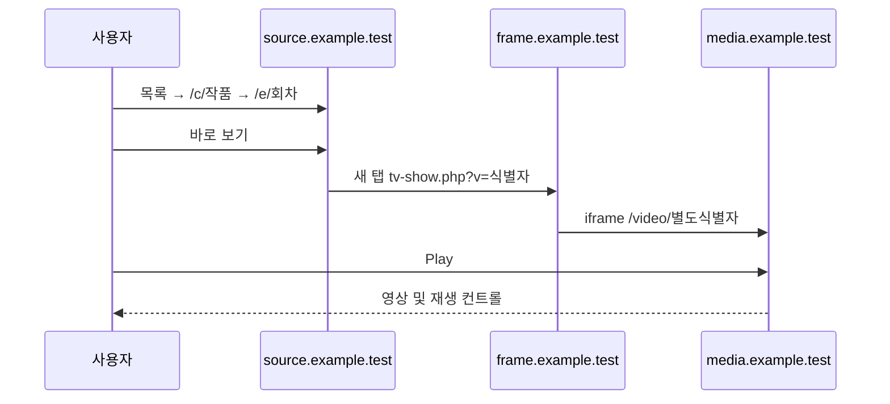

# 사이트 및 재생 흐름 조사

## 조사 범위와 방법

요청된 세 목록을 Codex 내장 브라우저 Browser Use로 직접 열고, 각 목록에서 한 작품과 한 회차를 클릭하여 `바로 보기` 및 외부 Play를 실행했다. 최초 방영중 목록만 Chrome에서도 확인했으며 이후 상세·외부 재생 및 나머지 목록은 모두 내장 브라우저에서 확인했다. 로그인·댓글·평점·북마크 변경은 하지 않았다. 웹페이지의 면책 문구는 운영자의 주장일 뿐 권리 확인 근거로 간주하지 않는다.

DOM/접근성 트리, 탭 URL, 화면, iframe의 video 속성을 관찰했다. 네트워크 HAR, 응답 헤더/본문, 자바스크립트 번들 분석은 수행하지 않았다. 표본은 세 편이므로 전체 콘텐츠·서버에 일반화하지 않는다. 날짜·제목은 사이트 표시값이며 외부 작품 정보와 대조하지 않았다.

## 관측 원장

| ID | 관측 | 설계에 미치는 영향 |
|---|---|---|
| OBS-01 | [방영중](https://source.example.test/방영중): 요일 필터, 작품 카드, Update 표시, 갱신 날짜·최신 회차 | 방영일 필터와 최신화 바로가기를 제공 |
| OBS-02 | [종영](https://source.example.test/종영): 검색·장르·연도·정렬, 연도·총회차 카드, 118쪽 표시 | 페이지 단위 로딩, 필터 상태 저장 |
| OBS-03 | [극장판](https://source.example.test/극장판): 같은 라이브러리 형태, 28쪽 표시; 분 단위와 회차 단위 항목 혼재 | 카테고리만 보고 단일 영화로 강제 변환하지 않음 |
| OBS-04 | 작품 `/c/…`: 제목·포스터·메타데이터·줄거리·첫 화 보기·회차 목록. 종영 회차에 `(完)` 표시 | 회차 라벨 원문 보존, 숫자 별도 파싱 |
| OBS-05 | 회차 `/e/…`: 회차 보기 영역, 바로 보기 버튼, 이전/다음 회차 링크. 최신·최종 표본은 이전화만 존재 | 링크 존재 여부가 이동 가능 여부의 근거 |
| OBS-06 | 바로 보기 버튼 클릭은 원본 회차 탭을 유지하고 `frame.example.test/tv-show.php?v=…` 새 탭 생성 | 팝업의 목적지를 검증하고 앱 재생 영역으로 라우팅 |
| OBS-07 | frame-host 페이지의 iframe은 `media.example.test/video/…`, 문서 제목 Anibeast. 광고 iframe과 별개 | 중개 페이지·임베드·미디어 주소를 분리 |
| OBS-08 | Play 뒤 Pause·탐색·볼륨·설정·전체화면 노출 및 영상 프레임 확인 | 브라우저 재생은 성공. 네이티브 재생 성공과 구별 |
| OBS-09 | 세 iframe의 video.currentSrc 유형은 `blob:` | blob URL은 mpv에 전달할 서버 URL이 아님 |
| OBS-10 | 종영 장르 액션 선택 후 `?genres%5B0%5D=%EC%95%A1%EC%85%98&sort=update-desc`, 다음 쪽 href에 `&page=2` | 관측된 파라미터만 계약 후보로 사용 |
| OBS-11 | 정렬 메뉴: 업데이트 최신/오래된순, 공개일 최신/오래된순, 별점 높은순, 제목 가나다순 | UI 라벨 확인. 나머지 실제 파라미터 값은 미확인 |
| OBS-12 | banner 링크, runative 광고 iframe, frame-host Google 광고 및 영상 위 쇼핑 앵커 확인 | 요청 차단과 빈 공간 제거를 모두 수행 |

## 재생 표본

아래 URL은 조사 시점의 표본이며 제품 코드에 고정 매핑하지 않는다. `v` 값과 iframe 식별자 사이 변환 규칙은 확인되지 않았다.

| 분류 | 작품·회차 | frame-host v | iframe video ID | 재생 중 직접 관측 |
|---|---|---|---|---|
| 방영중 | 어떤 암부의 소녀공서 2화 | b127d13702f336fd7c4953b05c994106 | 3653cce234494bfbd33e077f4a028f66 | currentTime 62.762872, duration 1420.002249초, 1920×1080 |
| 종영 | 치오의 통학로 12화(完) | 9656bb047bdabdb000385e483a758fc8 | 2d680487650d66445b50d3d759eccad4 | currentTime 32.701314, duration 1439.980905초, 1280×720 |
| 극장판 | 파리에 피는 에투알 | bc9971dc8fa1eb3d282042f40041bdde | 1f10c3650a3aa5912dccc5789fd515e8 | currentTime 8.334408, duration 7206.199639초, 1920×1080 |

세 표본 모두 `paused=false`, `readyState=4`. 시간 관측과 영상 화면을 함께 확인했다. 음향 출력, 전체 영상의 작품 일치, 종료까지 안정성은 확인하지 않았다. 극장판 표시는 단일 제목이지만 회차 URL은 `/e/파리에 피는 에투알 1화`였다.

## 추론과 미확인

이 절은 최초 Browser Use 조사의 범위와 한계다. 이후 Rust 앱의 광고 차단·응답 관측·mpv 검증으로 확인한 HLS 형식 및 재생 결과는 [후속 검증 정본](../../../verification/playback/sot-005-playback-validation.md)을 따른다.

- blob 사용은 브라우저 내부 미디어 파이프라인의 단서다. 이것만으로 HLS·DASH·MSE·암호화·DRM 여부를 확정할 수 없다.
- pageAssets 관측 목록 26개에서 video 및 m3u8/mpd/ts/m4s 후보가 없었다. 상위 문서 관측 한계이며 미디어 요청이 없었다는 뜻이 아니다.
- 바로 보기 버튼의 DOM 속성은 type=button, class=watch-now 및 프레임워크용 data 속성이었다. 정적 href는 없었다. HTML 파서만으로 연결 주소를 얻을 수 있다고 단정하지 않는다.
- 연도·검색·요일 필터의 실제 파라미터, JSON API, SSR 범위, 쿠키/Referer 요구, 토큰 만료, HTTP Range, 코덱·자막·화질 목록은 미확인이다.
- 설정 버튼은 노출되었으나 옵션 목록을 확정하지 못했다. seek slider의 접근성 값이 duration 절반처럼 표시되어 현재 재생시간 근거에는 video.currentTime을 사용했다.
- WebView2 차단을 켠 상태의 실제 사이트 재생과 mpv 재생은 별도 구현 검증 대상이다. 이번 브라우저 관측은 제품의 차단 성공률 측정이 아니다.

## 재현 절차

세 목록에서 표본 작품 → 첫화/회차 → 바로 보기 → 생성된 frame-host 탭 → 임베드 Play. Pause 버튼만으로 성공 판정하지 않고 currentTime 증가와 프레임을 함께 본다. DOM 구조가 달라지면 이전 셀렉터를 추측해 재사용하지 않는다. 재검증 시 브라우저/엔진 버전, 분류·회차 URL, 차단 정책 버전, 재생 성공·실패 단계만 기록하고 쿠키·광고 추적 쿼리·서명 미디어 URL은 문서에 저장하지 않는다.
