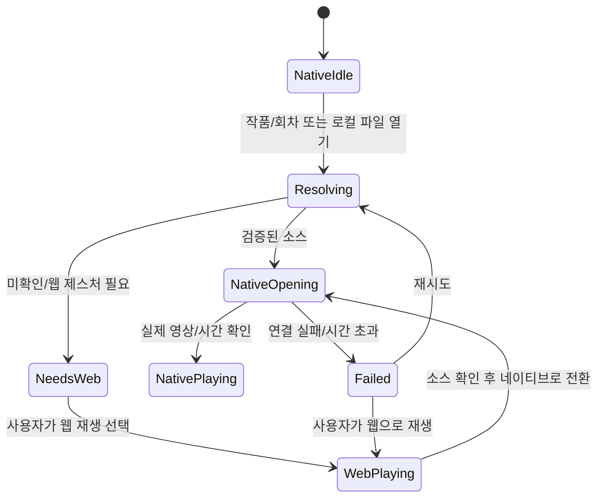

# 네이티브 우선 플레이어와 제작 UX

## 확정 범위와 구현 상태

사용자가 네이티브 플레이어 중심 UI를 확정했다. Windows 우선·Rust UI·PotPlayer 참고·광고 차단 기본 ON·단일 창·단일책임/모듈화/계층 구조는 유지한다. 웹은 작품 탐색, 정상 세션에서 미디어 확인, 호환 재생을 담당한다. 기본 영상 영역과 조작의 주체는 mpv다.

사용자 추가 답변: 원본 프레임 저장과 썸네일 편집 모두, 수동/자동 추천/여러 회차 일괄 숏폼 모두, SRT·VTT·ASS 변환과 이미지 자막 OCR까지 포함한다. 이후 카드뉴스(YouTube 커뮤니티/Instagram), 로컬 음성인식 자막, 피사체 인식, 2D/3D 투영용 에셋 제작을 설계 범위에 추가했다.

이 문서는 목표 UX다. 현재 실행 앱은 웹 중심 진입이며 자동 네이티브 우선 열기·제작 패널·내보내기·AI를 아직 구현하지 않았다. 기존 회차/네이티브 컨트롤의 관측은 [통합 검증](../../../verification/presentation/sot-006-integrated-ui-validation.md)과 [호스트 검증](../../../verification/playback/sot-010-host-endurance-validation.md)을 따른다. 설계 확정과 기능 완료를 구분한다.

## 리서치 사실과 해석

| 근거 | 확인한 사실 | 제품 설계에 적용할 해석 |
|---|---|---|
| [PotPlayer 공식 페이지](https://potplayer.tv/), 기존 [UX 조사](sot-004-player-ux.md) | 공식 홍보 이미지의 영상 중심·하단 조작·접이식 목록 | 익숙한 재생 조작을 기본 화면에 유지. 최신 설치 앱을 직접 시험했다는 뜻은 아님 |
| [Shotcut 24.08 공식 설명](https://shotcut.org/blog/new-release-240829/)과 [패널 이미지](https://shotcut.org/assets/img/blog/screenshot-subtitles.png) | 자막 트랙 선택, 텍스트/시작/끝 목록, 타임라인, 파일 내보내기와 burn-in 구분 | 자막 원본·영상 합성·구간 편집을 별도 선택으로 표시. 내장 브라우저에서 공식 패널 이미지를 직접 관찰 |
| [Subtitle Edit 공식 문서](https://subtitleedit.github.io/subtitleedit/) | 음성인식, 영상 OCR, 이미지 자막 OCR, 포맷 문서, 파형과 교정 기능이 구분됨 | 하나의 ‘AI 자막’ 버튼 안에 출처가 다른 작업을 섞지 않고 시작 시 방식/언어를 표시 |
| [mpv screenshot 명령](https://mpv.io/manual/stable/#screenshot-commands) | 원본 영상/자막 포함/창 캡처 선택 및 출력 드라이버에 따른 차이 | UI가 섞이지 않은 프레임 저장을 우선하고 포함할 자막을 명시. 실제 번들 mpv 검증 전 동일 결과 보장 금지 |

UI 레퍼런스는 공식 공개 문서/이미지 관찰이다. Shotcut·Subtitle Edit를 설치하고 전체 편집 흐름을 검증한 것은 아니다. 스킨·아이콘을 복제하지 않는다. 적용 스킬: architecture, frontend-design(ux-psychology), brainstorming. 핵심은 익숙한 조작, 점진 노출, 되돌리기, 눈에 보이는 작업 상태다.

## 단일 창 정보 구조

상단은 `열기/탐색 · 현재 작품/회차 · 제작 · 작업 · 설정`. 주소 입력은 탐색 패널 안으로 옮긴다. 영상 아래에는 진행바와 재생/이전/다음·시간·볼륨·자막·전체화면을 둔다. 웹/mpv를 동급 주 버튼으로 나열하는 현 UI는 `네이티브` 상태와 `웹으로 재생` 보조 동작으로 바꾼다.

```text
┌ 열기/탐색    작품 · 회차        제작   작업 2   설정 ┐
│                                           │ 회차  │
│             네이티브 영상                  │ 자막  │
│        (제작 시 크롭·안전영역 미리보기)     │ 제작  │
│                                           │       │
├──────────── 진행바 / 구간 표시 ─────────────┴───────┤
│ 이전  재생  다음  현재/전체  볼륨  자막  전체화면  │
└ 네이티브 · 해상도        차단 상태     작업 진행 ──┘
```

우측은 회차·자막·제작 중 하나의 맥락 패널만 연다. 제작 안의 종류는 `스냅샷/썸네일 · 숏폼 · 카드뉴스 · 에셋`이며 전체 종류를 재생 툴바에 펼치지 않는다. 다운로드와 자막 파일 저장은 현재 미디어 메뉴에서 접근하고 작업 큐를 공유한다. 좁은 창에서는 패널을 접고 제작 작업을 열 때 중앙 공간을 편집 화면으로 사용한다. 최소 창에서 영상·시간·취소 동작이 가려지지 않아야 한다.

제작 진입 시 재생 위치와 회차를 보존한다. 프레임/크롭 편집은 일시정지 후 시작하며 재생 복귀 버튼을 제공한다. 길게 실행되는 다운로드·ASR·렌더링은 화면을 점유하지 않고 작업 큐에서 진행한다. 전체화면 자동숨김은 기존 정책을 유지하되 편집 핸들 조작·자막 교정·키보드 포커스가 있으면 숨기지 않는다.

## 네이티브 우선 열기와 복구



미확인 URL을 mpv로 추측 전달하지 않는다. 새 회차의 소스를 기다리는 동안 이전 회차가 새 회차로 표시되지 않도록 제목·로딩 상태·세대를 함께 바꾼다. 정상 세션 처리에 필요한 WebView는 유지할 수 있으나 숨겨진 웹과 mpv의 소리가 중복되지 않아야 한다. 네이티브 실제 진행 확인 후 웹 pause를 전달하는 기존 계약을 계승한다. 사용자 제스처가 필요하면 작은 안내에서 웹을 연다. 실패 시 광고 차단을 자동 해제하지 않는다.

로컬 파일은 사이트 탐색 없이 네이티브로 연다. 웹 호환 재생 중 지원하지 않는 프레임 추출·정확 구간 편집은 이유와 ‘네이티브/로컬 소스로 열기’를 표시한다. 웹 전체 화면을 촬영해 영상 원본인 것처럼 저장하지 않는다.

## 공통 편집 계약

| 작업 | 첫 동작 | 미리보기/수정 | 완료 피드백 |
|---|---|---|---|
| 자막 | 트랙·파일·음성·OCR 중 출처 선택 | 언어/시간/스타일 손실·인식 불확실 구간 | 형식·저장 위치·변환 손실 요약 |
| 다운로드 | 현재 회차의 검증된 소스 선택 | 트랙/컨테이너/용량 추정/저장 위치 | 검증된 파일 열기·폴더 열기 |
| 스냅샷 | 현재 프레임 고정 | 자막 포함·원본/썸네일·크롭·텍스트 | 원본과 편집본 별도 저장 |
| 숏폼 | 직접 구간/자동 추천/일괄 | 구간 경계·세로 크롭·자막·소리 | 산출물별 성공/실패·다시 편집 |
| 카드뉴스 | 프레임/자막 근거를 카드에 추가 | 카드 순서·문구·레이아웃·플랫폼 미리보기 | 순번 파일·문구·프로젝트 묶음 |
| 투영 에셋 | 프레임에서 대상 클릭/박스 | 마스크·레이어·깊이·피벗·카메라 | 에셋 묶음·좌표/시간 메타데이터 |

텍스트 필드에는 플레이어 단축키를 적용하지 않는다. 구간 시작/끝은 키보드·숫자 입력과 드래그 모두 지원한다. 키 제안은 I/O(구간), S(프레임), Ctrl+Z(편집 취소)이며 기존 키 충돌·웹 포커스 회귀 후 확정한다. 단축키가 유일한 접근 수단이 되지 않는다.

선택·포커스·진행·오류를 색만으로 구분하지 않는다. 아이콘에는 툴팁과 접근 가능한 이름을 붙인다. 작업 전환 뒤 포커스를 호출 버튼으로 복원한다. 한국어 긴 제목, 빈 자막, 미지원 트랙, 모델 없음, 디스크 부족, 부분 실패 화면을 설계한다. 실제 DPI 검증은 사용자 보류이며 화면 설계로 대체하지 않는다.

## 인수 기준과 미검증

- 앱 최초 화면은 네이티브 빈 영상/열기이며 웹 사이트가 주 화면을 차지하지 않는다.
- 세 카테고리 회차 열기→네이티브 우선→실제 진행 및 이전/다음, 실패→명시적 웹 복구를 검증한다.
- 제작 패널을 닫고 복귀해도 회차/재생 위치/편집 초안이 유지된다.
- 작업 큐 진행/취소가 재생 조작을 막지 않으며 편집 포커스에서 자동숨김·재생 키가 오작동하지 않는다.
- 위 항목은 모두 후속 구현/실기 검증 대상이다. 상세 기능은 [저장·제작](../../application/production/sot-012-media-production.md), [로컬 AI·투영](../../application/analysis/sot-013-local-ai-projection-assets.md), 단계는 [확장 계획](../../../../plans/player/plan-003-native-studio-expansion.md)을 따른다.
